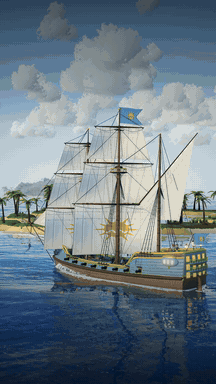
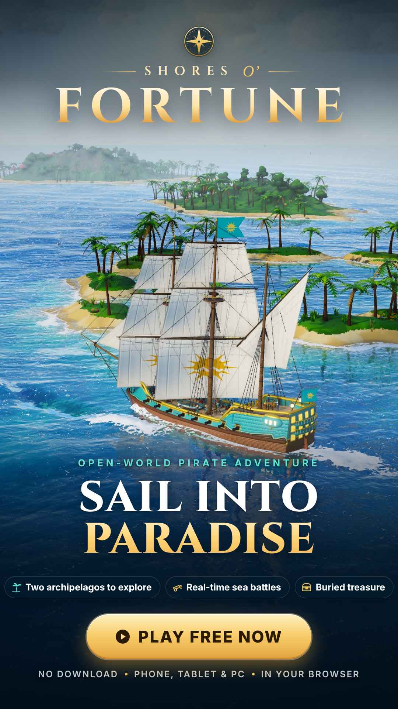
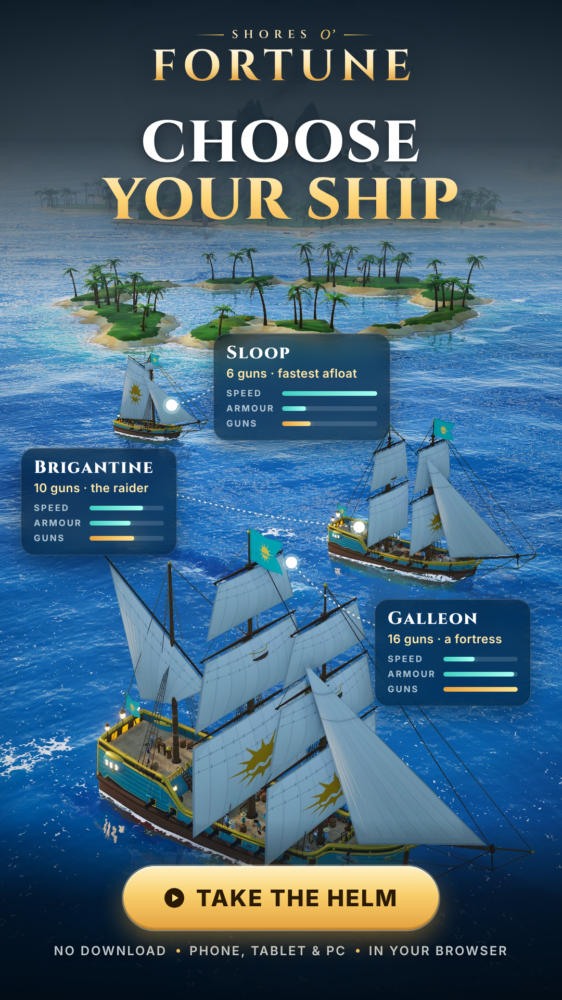
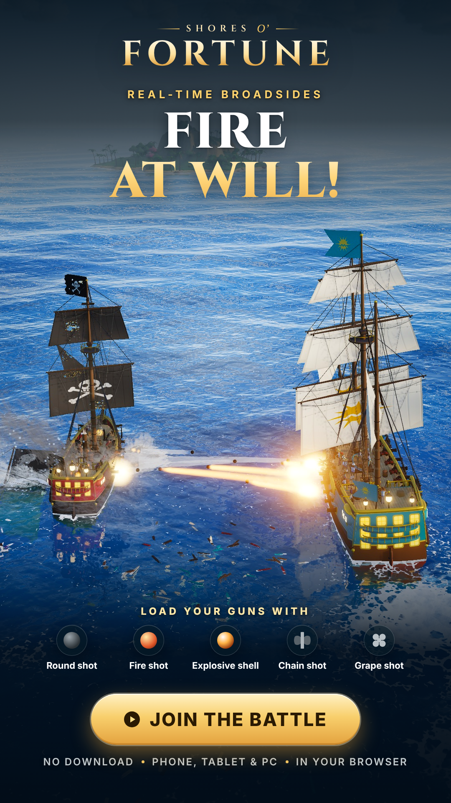
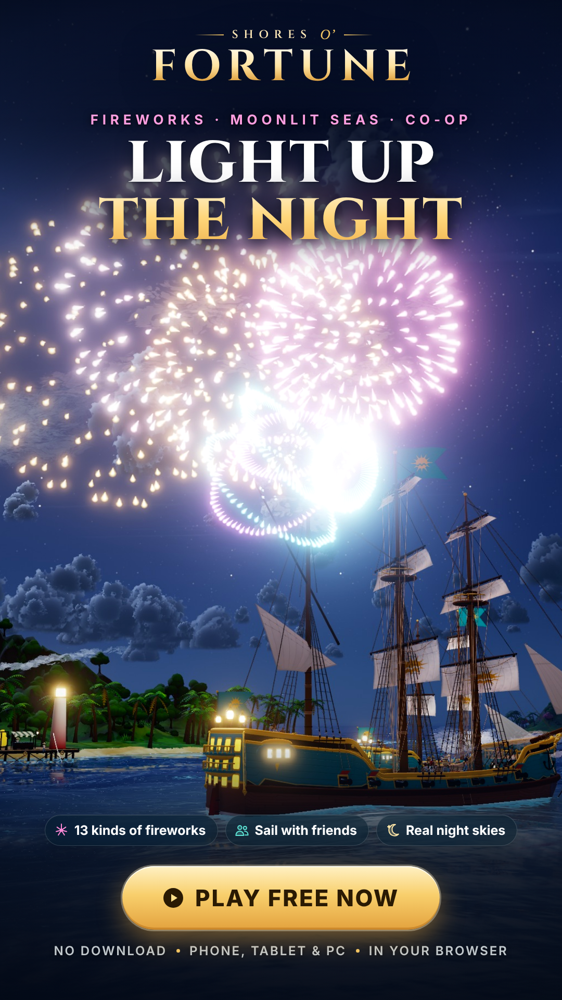
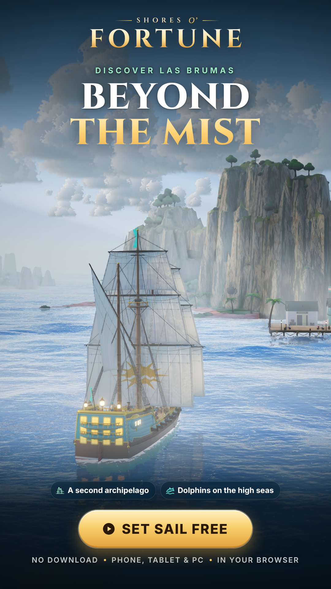
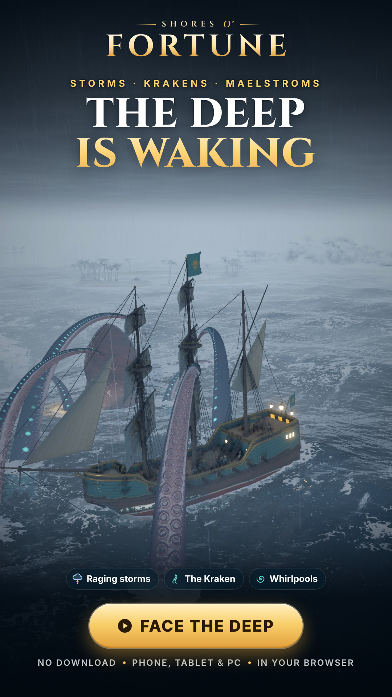

# Shores O’ Fortune · mobile ads

Ready-to-upload 9:16 ads for TikTok, Instagram Reels and Stories, YouTube Shorts and Snapchat.
Every frame is real in-game footage, rendered by the game itself at 1080 × 1920 on the highest graphics setting. Nothing is painted over or mocked up.

Click a **Download** link to save the full-resolution file.

## Video ads

| | | |
|:-:|:-:|:-:|
|  | **Main video · 22.5 s** Golden-hour sailing, Las Brumas in the morning mist, a fire-shot broadside, the Kraken in a storm by a maelstrom, and fireworks over the harbour at night. Ends on the logo and **Play free now**.  [Download MP4 (22 s)](https://github.com/jpcpais01/Aquati/raw/main/marketing/ads/shores-o-fortune-video-ad-22s.mp4) | **Short cut · 14.5 s** The same footage cut down for 15-second slots: sailing, the broadside, the fireworks and the end card.  [Download MP4 (15 s)](https://github.com/jpcpais01/Aquati/raw/main/marketing/ads/shores-o-fortune-video-ad-15s.mp4) |

- 1080 × 1920, 30 fps, H.264 + AAC. Both fit every platform's upload limit.
- **Sound:** the game's own soundtrack (*Sunset Archipelago*), mixed with the game's synthesized cannons, timber, splashes, fire shot and firework rockets and bursts. Each sound is timed to what's on screen.
- The text works with the sound off, since most feeds autoplay muted.

## Image ads

| | | |
|:-:|:-:|:-:|
|  |  |  |
| **1 · Sail into paradise** | **2 · Choose your ship** | **3 · Fire at will!** |
| [Download PNG](https://github.com/jpcpais01/Aquati/raw/main/marketing/ads/shores-o-fortune-ad-1-sail-into-paradise.png) | [Download PNG](https://github.com/jpcpais01/Aquati/raw/main/marketing/ads/shores-o-fortune-ad-2-choose-your-ship.png) | [Download PNG](https://github.com/jpcpais01/Aquati/raw/main/marketing/ads/shores-o-fortune-ad-3-fire-at-will.png) |
|  |  |  |
| **4 · Light up the night** | **5 · Beyond the mist** | **6 · The deep is waking** |
| [Download PNG](https://github.com/jpcpais01/Aquati/raw/main/marketing/ads/shores-o-fortune-ad-4-light-up-the-night.png) | [Download PNG](https://github.com/jpcpais01/Aquati/raw/main/marketing/ads/shores-o-fortune-ad-5-beyond-the-mist.png) | [Download PNG](https://github.com/jpcpais01/Aquati/raw/main/marketing/ads/shores-o-fortune-ad-6-the-deep-is-waking.png) |

## What each ad sells

| Ad | Hook | Shows |
|---|---|---|
| 1 · Sail into paradise | Explore | The galleon running past Cayo Solenne's palms and turquoise shallows on a bright afternoon. |
| 2 · Choose your ship | Variety | Sloop, brigantine and galleon in echelon off Morro Huracão, each tagged with its real gun count and its speed, armour and firepower from the game's ship stats. |
| 3 · Fire at will! | Combat | A fire-shot broadside crossing between the galleon and a black-sailed pirate brig, with the five kinds of shot. |
| 4 · Light up the night | Night & co-op | Fireworks bursting over the harbour under the stars, from two ships. |
| 5 · Beyond the mist | New waters | A misty morning among the karst towers of Las Brumas, the second archipelago. |
| 6 · The deep is waking | Danger | The Kraken's arms closing round the galleon in a storm, with a maelstrom turning behind. |

## Copy used

- Calls to action: *Play free now* / *Take the helm* / *Join the battle* / *Set sail free* / *Face the deep*.
- Footer: *No download · Phone, tablet & PC · In your browser*. It is accurate because the game is an installable web app.
- No reviews, ratings or download counts are claimed. Add the game's link in the ad platform's link field.

## Editing or re-making them

`source/` holds the layouts as plain HTML and CSS (the game's wordmark, Cinzel and Inter, frosted-glass chips) and the raw in-game captures behind them in `source/img/`. To change a headline, edit the HTML, open it in Chrome at a 1080 × 1920 viewport and take a screenshot. `source/overlay.html` is the video's animated text layer: its `render(t)` function draws any moment of the main timeline, and `overlay.html?short` draws the 15-second cut.
